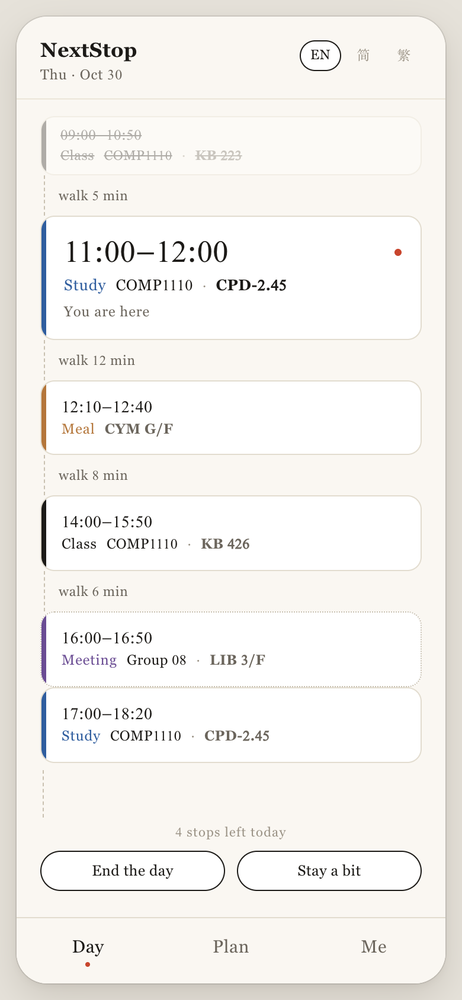
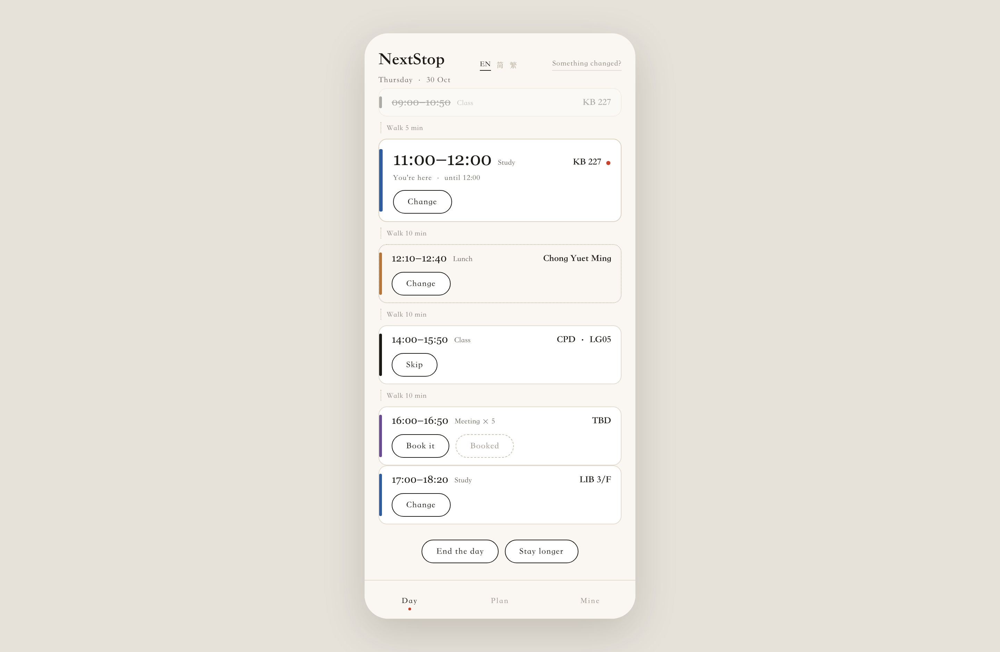
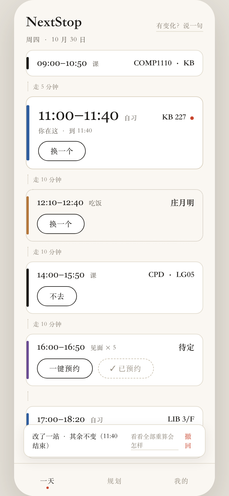
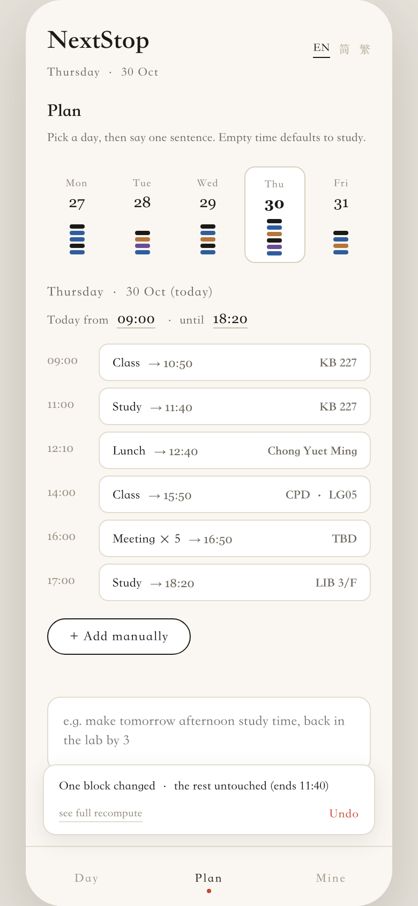

<p align="center">
  
</p>

<h1 align="center">Following It Is All You Need.</h1>

<p align="center">
  <b>NextStop</b><br>
  Decides where a student should go between classes, and keeps that decision standing when the day moves.
</p>

<p align="center">
  <a href="https://henryliu520.github.io/nextstop/"><b>▶ Try the prototype</b></a> &nbsp;·&nbsp;
  <a href="docs/why.md">Why it exists</a> &nbsp;·&nbsp;
  <a href="docs/architecture.md">Architecture</a> &nbsp;·&nbsp;
  <a href="docs/algorithm.md">Algorithm</a> &nbsp;·&nbsp;
  <a href="product/NextStop.pdf">One page PDF</a>
</p>

<p align="center">
  <a href="README.md">English</a> · <a href="README.zh-CN.md">简体中文</a> · <a href="README.zh-TW.md">繁體中文</a>
</p>

<p align="center">
  
  
  
  
  
</p>

---

<p align="center">
  
</p>

<p align="center"><sub>One interface. On a wide screen it sits in a phone frame, because it is the same interface.</sub></p>

A student leaves a lecture with seventy minutes in front of them. The campus is full of rooms.
What they do not know is **where to go**. A room finder answers *which rooms are empty*, a
calendar stores *what you already decided*, and neither answers the question the student actually
has, which is **what now**.

NextStop answers it. One card, one time, one destination. When the day moves it changes as little
as it can.

---

## What it is

| | |
|---|---|
| **It answers** | what to do with the next hour, and where |
| **It does not** | hand you a list and let you choose |
| **You do** | open it once a day, then follow it |
| **It is not** | a room finder, and not a calendar |

Three things a student does not know between two classes: **where they can go, where they are
allowed to go, what to do**. The room is one small step inside that.

---

## How it decides

```
1  Anchors     the timetable. Fixed, authoritative, never questioned.
2  Free time   gaps between commitments, minus walking and a buffer.
3  Fill        what goes in each gap, and where, from the availability layer.
4  Repair      when reality deviates, change as little as possible.
```

The hard part is not deciding a day. It is deciding **how little to change** when the day moves.
Two stops are the same stop only if the purpose, the building and the start time still line up.
Repair then climbs a cost order: move a few minutes, change room in the same building, change
building, drop a stop, and only then touch attendance, which is the user's decision.

> A finder answers a set. A plan answers a sequence.

---

## The interface

<p align="center">
  
  
  
</p>

<p align="center"><sub>Left: one card and the day as a stack. Middle: a 20 minute overrun changes one block, not five. Right: the week, one day, one sentence.</sub></p>

Three tabs, three jobs, no toolbar. Blocks carry their own actions: a class offers skip, a meal
offers change, a meeting offers booking. Nothing is ever empty, a gap defaults to study.

---

## Architecture in one screen

```
web/            Vue 3 + Vite, one build, four containers
                browser · PWA · Android shell · iOS shell
     |
     |  REST + JSON  (/api, proxied in dev)
     v
backend/        Spring Boot 4.1.1, Java 21, PostgreSQL 17
                timetable · rooms · availability · room updates · audit · accounts
     |
     v
mock-school-api/ simulated school feed (the real endpoint is not connected)
```

The backend stopped being the product. It answers *where can I be*, and it exists so the plan
never points at a place that does not exist. The plan lives in the client, which is why the
corridor case works with no signal.

---

## Documentation

Twelve documents, three languages each. Start with the first row.

| | English | 简体 | 繁體 |
|---|---|---|---|
| **Why this exists** | [`why.md`](docs/why.md) | [`zh-CN`](docs/why.zh-CN.md) | [`zh-TW`](docs/why.zh-TW.md) |
| **What it does that others do not** | [`highlights.md`](docs/highlights.md) | [`zh-CN`](docs/highlights.zh-CN.md) | [`zh-TW`](docs/highlights.zh-TW.md) |
| **Every feature, by journey** | [`features.md`](docs/features.md) | [`zh-CN`](docs/features.zh-CN.md) | [`zh-TW`](docs/features.zh-TW.md) |
| **Architecture** | [`architecture.md`](docs/architecture.md) | [`zh-CN`](docs/architecture.zh-CN.md) | [`zh-TW`](docs/architecture.zh-TW.md) |
| **The algorithm** | [`algorithm.md`](docs/algorithm.md) | [`zh-CN`](docs/algorithm.zh-CN.md) | [`zh-TW`](docs/algorithm.zh-TW.md) |
| **Screens and rules** | [`screens.md`](docs/screens.md) | [`zh-CN`](docs/screens.zh-CN.md) | [`zh-TW`](docs/screens.zh-TW.md) |
| **Decision records** | [`adr/`](docs/adr/README.md) | [`zh-CN`](docs/adr/README.zh-CN.md) | [`zh-TW`](docs/adr/README.zh-TW.md) |
| **All of it, indexed** | [`docs/README.md`](docs/README.md) | [`zh-CN`](docs/README.zh-CN.md) | [`zh-TW`](docs/README.zh-TW.md) |

Four decisions are recorded as ADRs: the backend is the data layer, the plan lives in the client,
a deviation repairs instead of recomputing, and one build serves four containers.

---

## Run it

```bash
git clone https://github.com/HenryLiu520/nextstop
cd nextstop

./scripts/start-all.sh                  # PostgreSQL 5433 → Spring Boot 8080
cd web && npm install && npm run dev    # http://127.0.0.1:5175
```

`web/` proxies `/api` to 8080, so the day you see is built from real availability answers. The
planning rules behind it are still a stub, which the interface does not hide.

No build step wanted? Open [`product/demo/index.html`](product/demo/index.html), one file, or use
the hosted copy: <https://henryliu520.github.io/nextstop/>.

---

## Built, specified, not built

| Part | State |
|---|---|
| Availability engine, rules, roles, audit, 27 tests | **built and tested** |
| Web interface, three tabs, three languages, real availability | **built** |
| Single file prototype, clickable end to end | **built** |
| Planner and repair ladder | **specified, not implemented** |
| Learning layer | **specified, not implemented** |
| PWA manifest, Android and iOS shells | **chosen, not built** |

We do not claim more than that. The timetable is sample data. "Free" is not "empty". The
one-block-versus-five-block comparison is illustrative, not a measured result. Authentication is
prototype grade.

---

## Repo map

```
web/               the interface: Vue 3 + Vite, one codebase for phone and desktop
backend/           Spring Boot service: timetable, availability, accounts, audit
frontend/          earlier desktop client, kept because the availability work lives here
mobile/            earlier phone client, same reason
mock-school-api/   simulated school timetable feed, with its design log
docs/              twelve documents, start at docs/README.md
product/           prototype, screenshots, one page PDF
scripts/           start / stop / test
```

---

<p align="center"><sub>
COMP1110 Group 08 · The University of Hong Kong · LIU Haoran (u3686264)<br>
Coursework. Third party components are credited in <a href="THIRD-PARTY.md">THIRD-PARTY.md</a>.
</sub></p>
