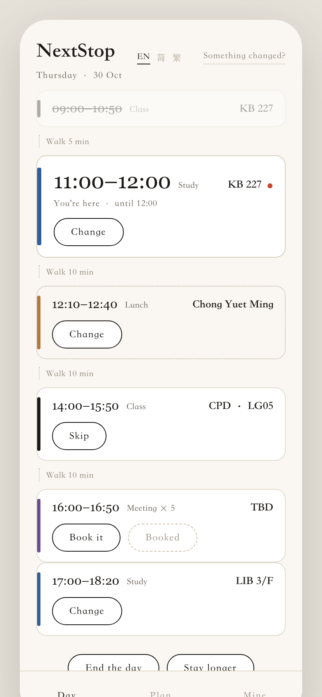
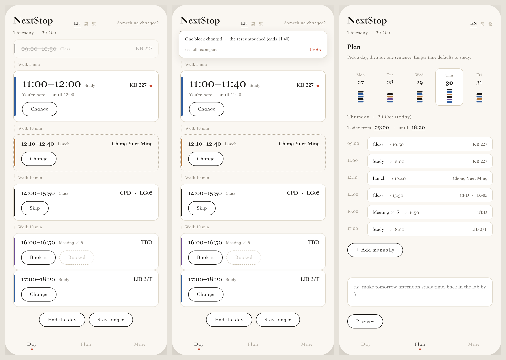

<h1 align="center">Following It Is All You Need.</h1>

<p align="center">
  <b>NextStop</b><br>
  <b>Class ends and you are free.</b><br>
  It picks the next stop before you reach the stairs.
</p>

<p align="center">
  <a href="https://henryliu520.github.io/nextstop/"><b>▶ Try the prototype</b></a> &nbsp;·&nbsp;
  <a href="docs/why.md">Why it exists</a> &nbsp;·&nbsp;
  <a href="docs/highlights.md">What makes it different</a> &nbsp;·&nbsp;
  <a href="product/NextStop.pdf">One page PDF</a>
</p>

<p align="center">
  <a href="README.md">English</a> · <a href="README.zh-CN.md">简体中文</a> · <a href="README.zh-TW.md">繁體中文</a>
</p>

<p align="center">
  
  
  
  
  
</p>

<p align="center">
  
</p>

<p align="center"><sub>One card, one time, one destination. The rest of the day sits underneath.</sub></p>

---

It is 09:47 on a Thursday. The lecture in KB just ended, the next one is at 11:00 in CPD, and the
walk between the two buildings takes eleven of the minutes in between.

You will spend a while putting off the choice. Then you will walk to CPD and sit outside the room
for another forty, because a place you are certainly allowed to sit asks only that you stay.

The hour slipped away on its own. The choice stayed open to the last minute.

NextStop decides it.

---

## Context

- The **international student** who landed this term and spends the full ninety minutes hunting for a seat.
- The **first-year after gaokao**, in the first term nobody tells them where to go and grind.
- The one in the **lift lobby**, eleven minutes into choosing a floor.
- The one **eating lunch at 15:40**, because the noon decision was too big.
- The **five who all said "wherever you want"**, then spent twenty minutes going nowhere.

All five own a phone that knows exactly which rooms are empty.

---

## ⚡ Extremely convenient

**You open it and the day is already there. One card, one time, nothing to fill in.**

The room finder, the tool this app replaces, asks you to fill **four boxes**, which building, which day, from what time until what time, and every one of those answers is already in its hands, because it holds your timetable. Getting through a day here is a count that only shrinks: **3 steps, then 2, then 1**, with zero as the target, and zero is attainable, because reading costs zero.

Fill runs once, at reveal. The plan is published and stays read-only until something moves, and opening the app again draws the same plan out of memory in one step. That is how the form goes away. A form is where the system asks a question after the answer already exists, and once the day is computed at reveal, every moment that follows already carries the answer with it. After publish, the only writer is repair.

> The cost is the night before. The arithmetic has to finish inside the second you open the app, on the phone, so the plan ships within that same second. Availability arrives as one fetched window, because one fetch covers every room at once.

*Implemented: the reveal and the read-only plan. The operation counts are a design sequence, with no measurement behind them.*

---

## 📈 Self-learning

**It works out how fast you walk from actions you already perform.**

It learns **four quantities**, each read from an action you perform anyway. Walking speed comes from the gap you leave before pressing "I am late". When your day ends comes from the moment you tap "End the day". Where you actually eat comes from which option you pick when several are open. Whether you attend comes from pressing "Not going". The walking factor is designed to travel from ×1.00 to ×1.28.

A value moves only after **three observations** land on it, which is the entire gate. Under three, the default stands and the screen says "still learning you" beside it. At the third, the parameter takes the observed value, smoothed, so one strange Tuesday counts as one data point inside the average. Only parameters move while the algorithm stays fixed, so a learned value can be audited by reading one number. The Me screen is where these values are meant to live: visible, editable, each with its counter beside it, and editing one resets that counter.

> The cost is that learning turns exactly the knobs placed there in advance. It works with the rules, the cost ladder and the actions that already exist. And the attendance rate stays on the device: totals accumulate locally, and screens show the parameters with their counters.

*Designed, implementation pending. The prototype runs on fixed defaults while showing the still learning label.*

---

## 🧠 Highly intelligent

**From a timetable and one round of preferences it produces the whole day.**

Walking time and a buffer are subtracted from every gap. Every remaining gap gets a purpose and a place. The meal is given a latest departure time, and the schedule reads its end from that moment. Study fills whatever is left, so every gap holds something. You can check all of it by walking the day, and a general assistant sounds most convincing exactly where your checking runs out.

A sentence presses the buttons that already exist, so the box holds exactly four destinations. First comes a preview: the affected block, the new end time, and the line that every other block keeps its time. Applying writes the same undo record a tap would. An unmatched sentence returns a refusal line, and the day keeps its written state, because silence would cost the box your trust. Every capability passes the **removal test** before language may touch it: take the box away and a complete app remains. When the day breaks, repair replaces recompute, rewriting **one block** where a full solve would rewrite five. A stop survives while its purpose, building and start time hold.

> The cost is a ceiling on phrasing. A request that needs a new kind of operation fails out loud on the spot, so the box refuses more than a chat window would.

*Implemented: the four actions and their undo records. The preview covers one worked sentence, with no parser behind it.*

---

## Screens

<p align="center">
  
</p>

<p align="center"><sub>Left: the day as a stack · middle: a 20 minute overrun, repaired, one block moved · right: the week, one day, one sentence.</sub></p>

A class offers Skip, a meal offers Change, a meeting offers Book it. Nothing is ever empty, and
a gap defaults to study.

---

## Planning pipeline

Five steps, in order, every time.

1. **Read.** The timetable arrives from the school feed, the pipeline reads it straight off the wire, and it takes every entry as correct.
2. **Sync.** A calendar subscription merges in, and data flows one way, from the calendar into the app.
3. **Add.** The one-off things you enter yourself, a dentist appointment, a parcel to collect. Same weight as a class, and you can delete yours at any time.
4. **Union.** The three become one list of committed time. Overlaps merge, and neighbours closer than fifteen minutes merge too, because a ten minute gap counts as a corridor.
5. **Subtract.** Walking time and a buffer come off every gap, and walking is multiplied by your
own factor, 1.00 until it learns otherwise.

What is left is a set of windows. Each one gets a purpose and a place. A meal gets a latest
departure time, and study fills whatever remains, so every window stays full. Then the room,
where the hard filters run first, free for the whole window, enough seats, you are allowed in,
the building you just left drops off the list, and a cost picks among the survivors.

```
F = wS x S'  +  wD x D

S'  the room itself, seven factors, after the rejection discount
D   the walk in, and how long the room stays free
wD  0.40 to 0.65, a longer window leans harder on S'
```

A failed filter ends that candidate. The weights only choose between rooms that already passed.

The room choice behind that last step has its own score, seven static factors plus a rejection
discount, written up in **[room-scoring.md](docs/room-scoring.md)**. The chain that runs before it,
from the three sources through the union, the buffer arithmetic and the three windows of a worked
Thursday to one published sequence, is walked step by step in **[day.md](docs/day.md)**.

---

## Deviation and repair

A class overruns by twenty minutes. Two ways to answer:

```
RECOMPUTE EVERYTHING            REPAIR
────────────────────────        ────────────────────────
11:00–12:00  Study   →  11:00–11:40 Study      ← changed
12:10–12:40  Lunch   →  11:50–12:20 Lunch      ← changed
14:00–15:50  Class   →  14:00–15:50 Class        same
16:00–16:50  Meeting →  15:40–16:30 Meeting    ← changed
17:00–18:20  Study   →  16:40–18:00 Study      ← changed

5 blocks moved                  1 block moved
```

Five blocks moving is how a plan loses your trust. Repair asks a narrower question than "what is
the best new day". It asks which stops are actually broken, touches only those, and counts two
stops as the same stop when the purpose, the building and the start time still line up.

**[algorithm.md](docs/algorithm.md)** for the criterion, the procedure and the cost order.

---

## Architecture

```
app      one HTML file, no build step
(demo/)  product/demo/index.html · browser · PWA
         NextStop is a phone app: Day · Plan · Find · Me, four views, one file
   |
   |  REST + JSON
   v
backend  Spring Boot + PostgreSQL
         timetable · rooms · availability · audit · accounts
```

Planning, repair and the interface all run in the client, so the corridor case keeps working with no signal in the corridor. The availability service underneath was built earlier in the project and answers one question well, which rooms are free, so the plan points only at places the service lists as free.

---

## What's included

- The clickable prototype ships as one file, it covers three languages and runs offline.
- The availability service, built earlier in the project, runs on Spring Boot with PostgreSQL, answers which rooms are free, and passes 32 tests.
- The planner is a stub today, it returns a shaped day and hands the solving step to the roadmap.

## Documentation

| | English | 简体 | 繁體 |
|---|---|---|---|
| **Why this exists** | [`why.md`](docs/why.md) | [`zh-CN`](docs/why.zh-CN.md) | [`zh-TW`](docs/why.zh-TW.md) |
| **What makes it different** | [`highlights.md`](docs/highlights.md) | [`zh-CN`](docs/highlights.zh-CN.md) | [`zh-TW`](docs/highlights.zh-TW.md) |
| **Every feature** | [`features.md`](docs/features.md) | [`zh-CN`](docs/features.zh-CN.md) | [`zh-TW`](docs/features.zh-TW.md) |
| **Architecture** | [`architecture.md`](docs/architecture.md) | [`zh-CN`](docs/architecture.zh-CN.md) | [`zh-TW`](docs/architecture.zh-TW.md) |
| **The repair criterion** | [`algorithm.md`](docs/algorithm.md) | [`zh-CN`](docs/algorithm.zh-CN.md) | [`zh-TW`](docs/algorithm.zh-TW.md) |
| **Room scoring** | [`room-scoring.md`](docs/room-scoring.md) | [`zh-CN`](docs/room-scoring.zh-CN.md) | [`zh-TW`](docs/room-scoring.zh-TW.md) |
| **Screens and rules** | [`screens.md`](docs/screens.md) | [`zh-CN`](docs/screens.zh-CN.md) | [`zh-TW`](docs/screens.zh-TW.md) |
| **Decision records** | [`adr/`](docs/adr/README.md) | [`zh-CN`](docs/adr/README.zh-CN.md) | [`zh-TW`](docs/adr/README.zh-TW.md) |
| **Everything, indexed** | [`docs/README.md`](docs/README.md) | [`zh-CN`](docs/README.zh-CN.md) | [`zh-TW`](docs/README.zh-TW.md) |

---

## Running locally

```bash
git clone https://github.com/HenryLiu520/nextstop
cd nextstop

./scripts/start-all.sh                  # PostgreSQL 5433 → Spring Boot 8080
cd web && npm install && npm run dev    # http://127.0.0.1:5175
```

`web/` proxies `/api` to 8080, so the day on screen is built from real availability answers.

No build step? Open [`product/demo/index.html`](product/demo/index.html). One file, no server,
works offline, three languages in the header.

---

## Roadmap

- The planner will learn to fill a gap.
- The sentence box will connect to the four actions.
- The PWA and the two phone shells will ship.

---

<p align="center"><sub>
COMP1110 Group 08 · The University of Hong Kong · LIU Haoran (u3686264)<br>
The name is a pun on a paper about attention.
</sub></p>
