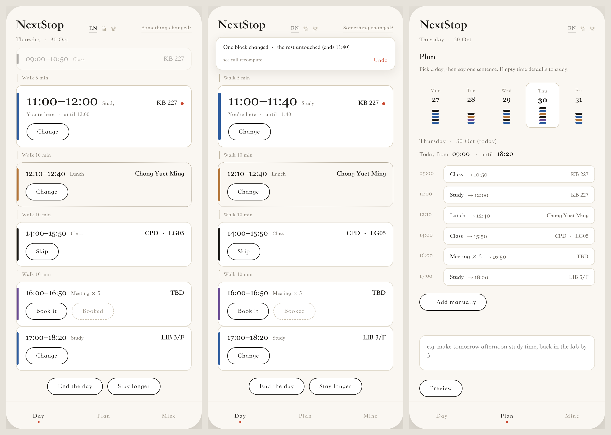

<h1 align="center">Following It Is All You Need.</h1>

<p align="center">
  <b>NextStop</b><br>
  你有 73 分钟，没有计划。<br>
  它替你写一张，一天动了，它修。
</p>

<p align="center">
  <a href="https://henryliu520.github.io/nextstop/"><b>▶ 试一下原型</b></a> &nbsp;·&nbsp;
  <a href="docs/why.zh-CN.md">为什么有这个项目</a> &nbsp;·&nbsp;
  <a href="docs/highlights.zh-CN.md">它凭什么不一样</a> &nbsp;·&nbsp;
  <a href="product/NextStop.pdf">一页 PDF</a>
</p>

<p align="center">
  <a href="README.md">English</a> · <a href="README.zh-CN.md">简体中文</a> · <a href="README.zh-TW.md">繁體中文</a>
</p>

<p align="center">
  
  
  
  
  
</p>

<p align="center">
  
</p>

<p align="center"><sub>一张卡，一个时间，一个去向。这一天剩下的部分在下面。</sub></p>

---

周四 09:47。KB 的课刚下，下一节 11:00 在 CPD，中间 73 分钟，走路吃掉十一分钟。

你会先花一阵子不决定，然后走去 CPD，在教室外面再坐四十分钟。因为你确定自己能坐的地方，什么都不要求你。

那一小时不是被故意浪费的。它只是从来没被决定。

NextStop 把它决定掉。

---

## 这事总落在谁头上

- **国际生**，这学期刚落地，九十分钟还不知道能坐在哪。
- **刚考完高考的第一年**，再没有人告诉你去哪接着卷。
- **电梯口那位**，在"按几楼"这件事上已经想了十一分钟。
- **15:40 才吃上午饭那位**，中午那个决定太大了。
- **五个人都说"随便"**，然后二十分钟哪儿也没去。

这五个人手里的手机，都知道哪些教室空着。📱

---

## ⚡ 极度方便

找空教室的应用给你一张列表，再让你填四个它其实知道答案的框。它有你的课表。空档 73 分钟它知道，走路十一分钟它也知道。NextStop 什么都不问。打开就是答案，一张卡，一个时间，一个去向。KB 227，到 12:00，步行 5 分钟。

一天要做的操作数，是这里唯一要数的数，它只能往下走。第一版是 3，选教室、选时间、确认一天。时间能从空档里直接算出来，降到 2。打开应用的那一刻，那一天就已经算好，降到 1，剩下的工作只有打开。目标是 0，读到的那天就是对的。每个新功能都得在卡里面付账，不许用新屏幕、新问题来付。

算术全部在手机上跑，走廊里没信号，不算它失败的场合。计划只在打开那一刻算一次，之后只读。再打开，渲染的是手里已经有的同一天，下午不会趁你看它的时候自己重排。功能都长在计划层里，到屏幕上的，始终只有一张卡。

---

## 📈 越用越聪明

NextStop 学四个数，每个都来自你本来就在做的动作，从不来自一张表单。点"我迟到了"，计划和你点击之间的差，就是你真实走路的速度。点"结束今天"，那个钟点就是你一天真正的收工时间。改一餐时选的那个选项，就是你真的去吃的地方。在某节课上点"不去"，那节课你就是不去。

每个数是一个参数加一个计数器。没有模型文件，没有训练，做计划时也没有一次推理。观察不满三次，默认值站着不动，界面写着"还在学你"。电梯坏了晚到一次，不会让你一学期都背着走路慢的名声。学习永远不改算法。走路系数 1.28 只乘步行矩阵，别的什么都不碰，所以审计它只需要读一个数。

每个值都在 Mine 页上，带着自己的计数器，用的是计划层的单位。看得到，也改得掉。改掉保存，计数器清零，接下来三次观察会在你给的数上继续打磨，而不是跟它吵架。

*现状：这些值今天就在 Mine 页上，可以直接改。从动作推出它们的推导层还在设计里，没有跑。*

---

## 🧠 极度智能

NextStop 拿一张课表和一轮偏好，算出一整天。每个空档先减掉步行和缓冲，再往里放东西。每个空档拿到一个目的、一个地点，没有空的空档。一顿饭不塞猜出来的时长，它拿到的是一个最晚出发时间，和两个选项。

一句话改计划。"明天下午留白自习，三点前回实验室"会拆成一串已经存在的动作，先预览，再应用，随时撤销。语言是同一排按钮的第二扇门，不是特权通道。一句话落不进已有动作，它就失败，并且明说，不发明能力。把输入框删掉，剩下的还是一个完整应用，这是每个能力见到语言之前要过的测试。

一天动了，它修，不重算。拖堂二十分钟，动一块，全盘重算动五块。一站能活过修复，靠它的目的、它的楼、它的开始时间仍然对得上。底下它同时称量几件事，你走多远，你等多久，你吃没吃饭，下一件事有多硬。

*现状：这一段背后的规划器今天是个桩。修复阶梯和句子解析还在设计里，没有跑。*

---

## 它长什么样

<p align="center">
  
</p>

<p align="center"><sub>左：一天一叠块 · 中：拖堂 20 分钟，修好，只动一块 · 右：一周，一天，一句话。</sub></p>

课给"不去"，饭给"换一个"，会给"预约"。没有空的空档，空档默认自习。

---

## 一天动起来的时候

一节课拖堂二十分钟。两种答法：

```
RECOMPUTE EVERYTHING            REPAIR
────────────────────────        ────────────────────────
11:00–12:00  Study   →  11:00–11:40 Study      ← changed
12:10–12:40  Lunch   →  11:50–12:20 Lunch      ← changed
14:00–15:50  Class   →  14:00–15:50 Class        same
16:00–16:50  Meeting →  15:40–16:30 Meeting    ← changed
17:00–18:20  Study   →  16:40–18:00 Study      ← changed

5 blocks moved                  1 block moved
```

五块齐动，是计划失去信任的方式。修复问的比重算窄。它问哪几站真的断了，只动那几站，两站算同一站，靠的是目的、楼栋、开始时间都还对得上。

👉 判据、过程与代价顺序：**[algorithm.zh-CN.md](docs/algorithm.zh-CN.md)**

---

## 它是怎么搭的

```
web/     Vue 3 + Vite，一套构建，四个容器
         网页 · PWA · Android 壳 · iOS 壳
   |
   |  REST + JSON
   v
backend  Spring Boot + PostgreSQL
         课表 · 房间 · 可用性 · 审计 · 账号
```

计划、修复、界面全在客户端跑，走廊里没信号照样能用。底下的可用性服务是项目早期搭好的，它只把一个问题答准，哪些房间空着，所以计划不会指向不存在的地方。

### 从课表到一个房间

五步，顺序固定。

1. **读**。课表从学校的只读接口来，它被当作正确的，不校验，不质疑。
2. **同步**。日历订阅并进来，只读，不回写。
3. **加**。你自己塞的一次性事情，看牙、取快递。和课一样的分量，区别是你能删。
4. **并**。三个来源并成一份「已占用」。重叠的合并，相邻不到十五分钟的也合并，因为十分钟不是空档，是走廊。
5. **扣**。每个空档扣掉走路和缓冲，走路乘你自己的系数，还没学会之前是 1.00。

剩下的是一串窗口。每个窗口给一个目的和一个地点，吃饭给的是「最晚几点必须走」而不是猜出来的时长，剩下的全填自习，所以窗口不会空着。最后一件事是房间：先过硬条件（整段都空、座位够、你能进、不是你刚离开的那栋），再用代价在活下来的几间里挑。

```
代价 = 1.0 × 步行分钟
     + 0.3 × |楼层 − 你偏好的楼层|
     + 0.2 × (1 − 去过次数 / 10)
     + 0.5 × 噪音
```

任何一条硬条件不过，这间就出局。权重只负责在已经合格的房间里挑一间。

---

## 文档，每份三语

| | English | 简体 | 繁體 |
|---|---|---|---|
| **为什么有这个项目** | [`why.md`](docs/why.md) | [`zh-CN`](docs/why.zh-CN.md) | [`zh-TW`](docs/why.zh-TW.md) |
| **它凭什么不一样** | [`highlights.md`](docs/highlights.md) | [`zh-CN`](docs/highlights.zh-CN.md) | [`zh-TW`](docs/highlights.zh-TW.md) |
| **按旅程列的功能** | [`features.md`](docs/features.md) | [`zh-CN`](docs/features.zh-CN.md) | [`zh-TW`](docs/features.zh-TW.md) |
| **技术架构** | [`architecture.md`](docs/architecture.md) | [`zh-CN`](docs/architecture.zh-CN.md) | [`zh-TW`](docs/architecture.zh-TW.md) |
| **修复判据** | [`algorithm.md`](docs/algorithm.md) | [`zh-CN`](docs/algorithm.zh-CN.md) | [`zh-TW`](docs/algorithm.zh-TW.md) |
| **界面与规则** | [`screens.md`](docs/screens.md) | [`zh-CN`](docs/screens.zh-CN.md) | [`zh-TW`](docs/screens.zh-TW.md) |
| **决策记录** | [`adr/`](docs/adr/README.md) | [`zh-CN`](docs/adr/README.zh-CN.md) | [`zh-TW`](docs/adr/README.zh-TW.md) |
| **全部索引** | [`docs/README.md`](docs/README.md) | [`zh-CN`](docs/README.zh-CN.md) | [`zh-TW`](docs/README.zh-TW.md) |

---

## 跑起来

```bash
git clone https://github.com/HenryLiu520/nextstop
cd nextstop

./scripts/start-all.sh                  # PostgreSQL 5433 → Spring Boot 8080
cd web && npm install && npm run dev    # http://127.0.0.1:5175
```

`web/` 把 `/api` 代理到 8080，屏幕上这一天是用真实可用性答案拼出来的。

不想构建？打开 [`product/demo/index.html`](product/demo/index.html)，单文件，不用服务，能离线，右上角切三种语言。

---

## 哪些是真的，哪些不是

| 部分 | 状态 |
|---|---|
| 可用性引擎、规则、角色、审计、27 个测试 | **已实现并测试** |
| Web 界面，三个 tab，三语，真实可用性 | **已实现** |
| 单文件原型，可点完整流程 | **已实现** |
| Mine 页与可编辑参数 | **已实现** |
| 规划器 | **桩，每个空档放一个自习块** |
| 修复阶梯与同一站判据 | **已设计，未实现** |
| 学习层 | **已设计，未实现** |
| 一句话预览 | **原型里只有一句演示句** |
| PWA manifest、Android 与 iOS 壳 | **已选定，未构建** |

课表是样例数据。"空闲"不等于"没人"。"动一块 vs 动五块"是示例，不是实测。鉴权是原型级。那些学到的数，是设计的方向，不是实测值。

我们用这张表代替路线图。

---

<p align="center"><sub>
COMP1110 第 08 组 · 香港大学 · LIU Haoran (u3686264)<br>
名字是拿一篇讲 attention 的论文开的玩笑。
</sub></p>
