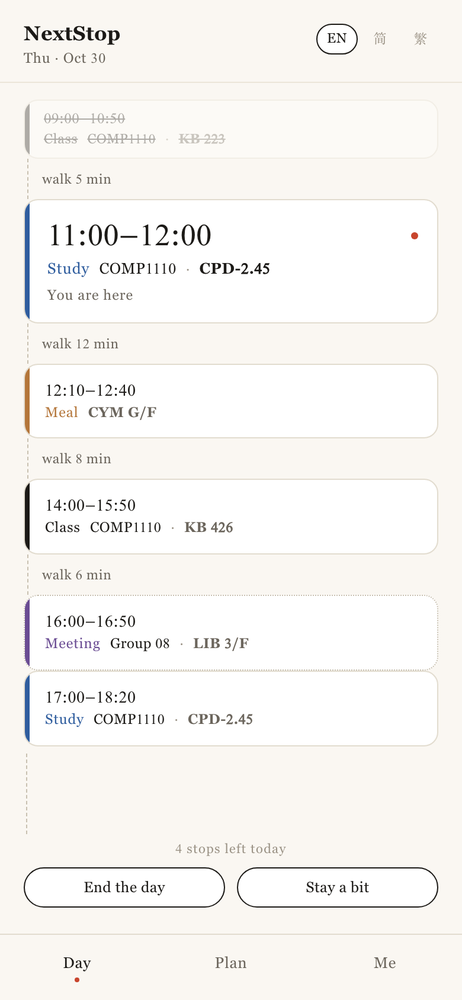
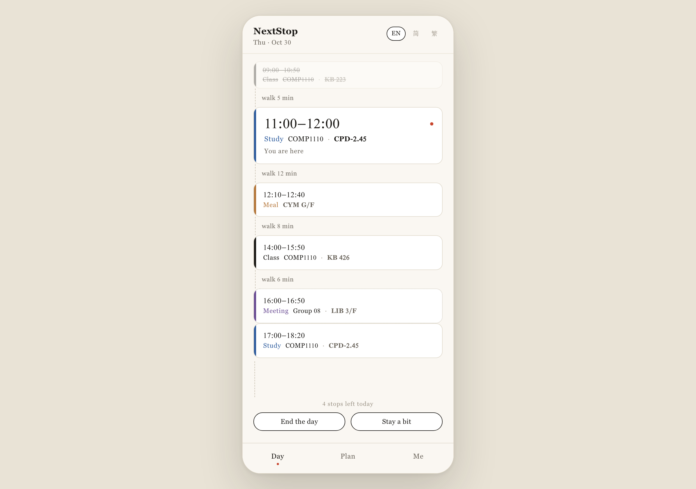

# NextStop

[English](README.md) · **簡體中文** · [繁體中文](README.zh-TW.md)

> Following It Is All You Need.

學生上完一節課走出來，手上還有七十分鐘。校園裡到處是空房間。
他不知道的是**能去哪裡**。NextStop 替他把這件事決定掉，並且在一天被打亂時守住這個決定。

COMP1110 第 08 組 · 香港大學 · 作者 **LIU Haoran (u3686264)**



---

## 它是什麼

| | |
|---|---|
| **它回答** | 接下來這一小時做什麼，以及在哪 |
| **它不做** | 給你一張清單讓你自己挑 |
| **你要做的** | 一天開啟一次，然後照著走 |
| **它不是** | 查詢器，也不是日曆 |

查詢器告訴你哪些房間空著。日曆存著你已經決定的事。兩者都不回答一個學生站在走廊裡真正的問題：**現在幹什麼**。

兩節課之間，學生不知道三件事：**能去哪裡、被允許去哪裡、做什麼**。房間只是其中一小步。

📄 **[一頁 PDF](product/NextStop.pdf)** · 🧭 **[為什麼有這個專案](docs/why.md)** · ✨ **[別人做不到的地方](docs/highlights.md)**

---

## 介面

一張卡。下面是一疊塊，塊與塊之間只寫走路時間。**沒有空著的時間**，空隙預設是自習。



三個 tab，三件事，沒有工具欄：

| Tab | 做什麼 |
|---|---|
| **一天** | 一張卡、一疊塊、四個動作 |
| **規劃** | 一週五列、下面是那一天、一句話改它 |
| **我的** | 它學到的數字，可改 |

細節：**[介面](docs/screens.md)**（塊規格、動作矩陣、設計令牌）與
**[功能](docs/features.md)**（按使用者旅程）。

---

## 它怎麼決定

```
1  固定    課表。權威、不可疑。
2  空出    承諾之間的空隙，扣掉走路和緩衝。
3  填      每段空隙放什麼、放哪，由可用性層給候選。
4  修復    現實偏離時，儘量少改。
```

真正難的不是決定一天，是決定**打亂之後最少改多少**。兩個停靠點算同一件事，必須目的、樓棟、開始時間都還對得上。修復按代價順序往上爬：挪幾分鐘、換同樓房間、換樓、取消一站，**最後才動出勤**，而出勤是人自己的決定。

> 查詢器回答一個集合。計劃回答一個序列。

判據、過程、複雜度與一個 worked example 都在 **[algorithm.md](docs/algorithm.md)**。

---

## 一張圖說清架構

```
web/            Vue 3 + Vite，一套構建，四個容器
                網頁 · PWA · Android 殼 · iOS 殼
     |
     |  REST + JSON（開發時由 Vite 代理 /api）
     v
backend/        Spring Boot 4.1.1、Java 21、PostgreSQL 17
                課表 · 房間 · 可用性 · 佔用變更 · 審計 · 帳號
     |
     v
mock-school-api/ 模擬學校課表源（真實介面尚未接入）
```

後端不再是產品。它是回答「我能去哪」的那一層，存在的意義是保證計劃不會指向一個不存在的地方。計劃在客戶端，所以走廊裡沒訊號也能用。

**[architecture.md](docs/architecture.md)** · 決策記錄在 **[adr/](docs/adr/)**
（0001 資料層、0002 計劃在客戶端、0003 修復而非重算、0004 一套介面四個容器）

---

## 跑起來

```bash
git clone https://github.com/HenryLiu520/nextstop
cd nextstop

# 資料層
./scripts/start-all.sh          # PostgreSQL 5433 → Spring Boot 8080 → 舊客戶端 5173

# 介面
cd web && npm install && npm run dev     # http://127.0.0.1:5175
```

`web/` 把 `/api` 代理到 8080，所以你看到的一天是用真實可用性資料拼出來的。背後的規劃規則仍是樁，介面不掩飾這一點。

還有一個**單檔案原型**，不用構建：開啟 [`product/demo/index.html`](product/demo/index.html)，或直接看線上版
<https://henryliu520.github.io/nextstop/>。右上角可切 English / 簡體 / 繁體。

---

## 做了什麼，沒做什麼

| 部分 | 狀態 |
|---|---|
| 可用性引擎、規則、角色、審計、27 個測試 | **已實現並測試** |
| Web 介面、三個 tab、三語、真實可用性 | **已實現** |
| 單檔案原型，可點完整流程 | **已實現** |
| 規劃器與修復階梯 | **已設計，未實現** |
| 學習層 | **已設計，未實現** |
| PWA manifest、Android 與 iOS 殼 | **已選定，未構建** |

逐功能的狀態表在 **[features.md](docs/features.md)**，缺什麼、為什麼缺在
[architecture.md 第 8 節](docs/architecture.md)。

---

## 倉庫結構

```
web/               介面：Vue 3 + Vite，一套程式碼兼顧手機與桌面
backend/           Spring Boot 服務：課表、可用性、帳號、審計
frontend/          早期桌面客戶端，保留因為可用性相關工作在這裡
mobile/            早期手機客戶端，原因同上
mock-school-api/   模擬學校課表源，含設計記錄
docs/              從 docs/README.md 開始
product/           原型、截圖、一頁 PDF
scripts/           啟動 / 停止 / 測試
```

舊客戶端不再展示，新介面在 `web/`。

---

## 我們守的幾條規則

1. **不問任何使用者本來不會做的事。** 沒有表單、沒有評分、沒有"這次準嗎"。
2. **課表是權威。** 我們不把它建模成"可能會錯"的東西。
3. **沒有空著的時間。** 允許"什麼都不排"的規劃器會退化成課表的影印件。
4. **動作屬於塊，不屬於頁面。** 沒有工具欄。
5. **每一次改動都可以撤回**，包括翹課。

---

## 我們不聲稱的事

- 課表是樣例資料。`V2__seed.sql` 是合理的模擬，學校介面尚未接入。
- "空閒"不等於"沒人"。系統回答"這間房有沒有被佔用"，從不回答"裡面有多少人"。
- "改一塊 vs 改五塊"是示例，不是實測結果。
- 鑑權是原型級。token 存在記憶體、密碼是加鹽 SHA-256、沒有 HTTPS。
- 學習層只有設計，介面用固定預設值。

---

## 許可與致謝

課程作業，不對外分發。第三方元件均按寬鬆許可使用（前端棧 MIT、Spring Boot 與 Flyway
Apache-2.0、PostgreSQL 許可、JDBC 驅動 BSD-2），逐項記錄在 [THIRD-PARTY.md](THIRD-PARTY.md)。
早期客戶端的佈局受 [vue3-element-admin](https://github.com/youlaitech/vue3-element-admin)（MIT）
啟發，**未複製其程式碼**。頁首使用學校校徽、字標與 HKU Green（#024638），僅用於標識這份課程原型。
